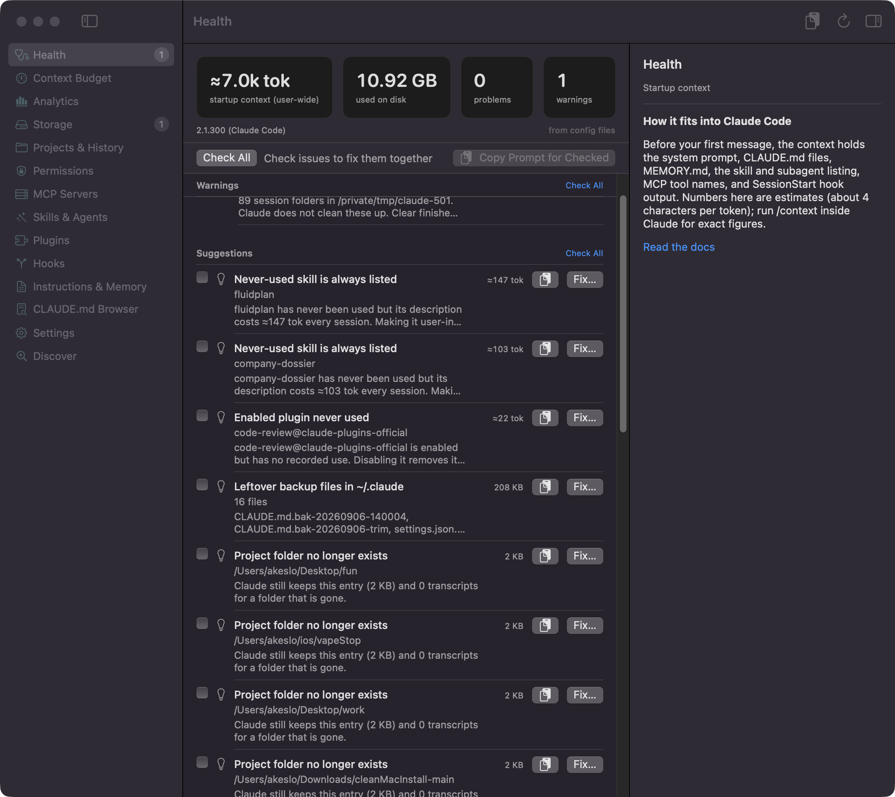
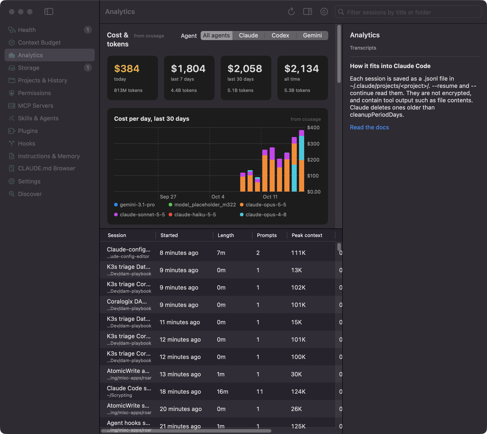
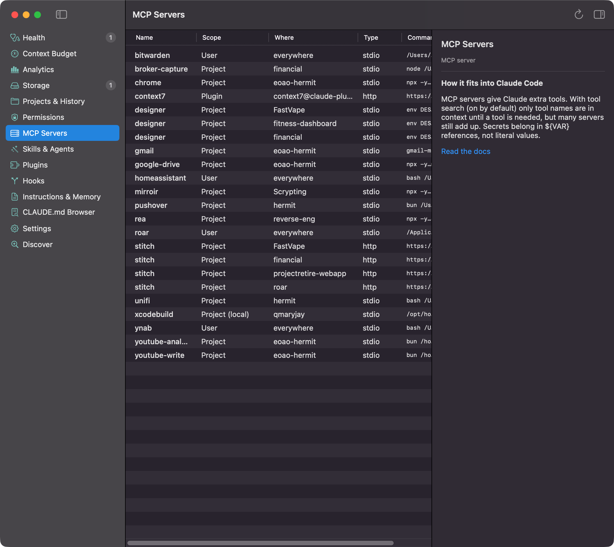

# Claude Config

A Mac app that shows why your Claude Code sessions start half full, and helps you trim them safely. Every skill, plugin, MCP server (a tool add-on) and memory file you've installed costs tokens at the start of every session, before you type anything. Claude Config lists what loads, what it costs, what takes disk space, and what's broken or risky. Every fix shows a preview first. It's the alternative to digging through `~/.claude` by hand and running `/context`.

Hover over any item for a plain explanation: what kind of thing it is, what this one does, and where it came from. The right-hand panel says where the item lives, when it loads, and links to the official docs. For plugin items, **View Source** opens the owner's repo.

Each issue also has a **Copy AI Prompt** button. It copies a request you can paste into Claude Code to fix the issue: it says what the fix changes and tells Claude to back up files and ask before deleting anything. Hover the button to read the exact prompt first. Check several issues to copy one combined prompt. Config text inside prompts is fenced and sanitized.

Forked from [gagarinyury/claude-config-editor](https://github.com/gagarinyury/claude-config-editor), which started as a web editor and is now a native macOS app.



| What your sessions cost (Analytics) | Every MCP server and where it's defined |
|---|---|
|  |  |

## Sections

| Section | What it shows |
|---|---|
| Review | Problems ranked by severity, each with the reason from Claude Code's docs, a **Fix…** button (preview first) and a copyable AI prompt |
| Guide | Best-practice advice per area, with sources |
| Context Budget | Estimated tokens loaded before your first message, every session and per project |
| Analytics | Cost and tokens from ccusage (today, 7 and 30 days, all time, per day by model, per model by agent), plus past sessions from transcripts: tokens per day, peak context, compactions, cache use, tools, models |
| Backups | `.bak` and other copies next to your config: diff, restore or trash |
| Storage | Scratch folders, transcripts, plugins, jobs, caches, backups: size, age, safety, auto-cleanup |
| Projects & History | Every folder Claude has run in, with transcript size; purge via `claude purge` |
| Permissions | allow / ask / deny rules from every scope, plus per-project approvals |
| MCP Servers | Servers in every scope (user, local, project, plugin, Claude Desktop) |
| Memory | CLAUDE.md, CLAUDE.local.md, rules, MEMORY.md and other agents' instruction files anywhere on disk (including backups), with context cost, problems and a preview |
| Skills | Your skills and what each costs per session; switch rarely used ones to On demand (still runs when you type /name) |
| Agents & Commands | Subagents, slash commands and output styles: listing cost, usage, overrides |
| Plugins | Installed plugins with always-on token cost (`claude plugin details`) |
| Hooks | Every hook by event and source; missing scripts and bad matchers |
| Settings | Every settings key by scope, keybindings, and `claude doctor` |
| Discover | Plugins from your marketplaces, by install count |

## Cost & tokens (via ccusage)

Analytics runs `npx -y ccusage@latest daily --json --by-agent` through your login shell and shows cost (USD at API prices) and input, output, cache-write and cache-read tokens per day, model and agent (Claude, Codex, Gemini). **Node is required**: without `npx` the section says "Install Node to see cost" and the transcript stats still work. Results are cached for the launch; ⌘R or Reload runs ccusage again. Each number is labelled with its source: ccusage or transcripts.

## Keyboard (Review)

| Key | Action |
|---|---|
| ↑ ↓ | Move between issues |
| Space | Check or uncheck the selected issue |
| ⌘A | Check or uncheck all |
| ⌘C | Copy the selected issue's AI prompt |
| ⇧⌘C | Copy one AI prompt for every checked issue |
| Return | Fix or open the selected issue |
| ⌘R | Rescan |

## Build and install

Requires macOS 15 and Xcode (Swift 6).

```sh
./build.sh          # builds, signs ad hoc, installs /Applications/Claude Config.app
swift test          # unit tests
```

## How changes are made

- The `claude` CLI is used where it has a command (`purge`, `mcp remove`, `plugin enable|disable|update|uninstall|install`); purge shows its `--dry-run` output first.
- Settings, hook and skill-frontmatter edits change one key and keep the rest. The file is backed up to `~/.claude/config-editor-backups/` first, and the save is refused if the file changed after it was read.
- Items you delete inside the app (memory files, transcripts, stale projects) are copied to `~/.claude/backups/config-editor/` first and can be undone.
- `claude purge` is permanent: it has no backup, so the app shows its `--dry-run` output and a warning before you apply it.
- Deletes in Storage go to the Trash. Locations Claude needs (`plugins/`, Claude's backups) are view-only.
- Managed settings are shown, never edited.

Token numbers are estimates (about 4 characters per token) except plugin costs, which come from `claude plugin details`. Run `/context` in Claude for exact figures.

## License

MIT
